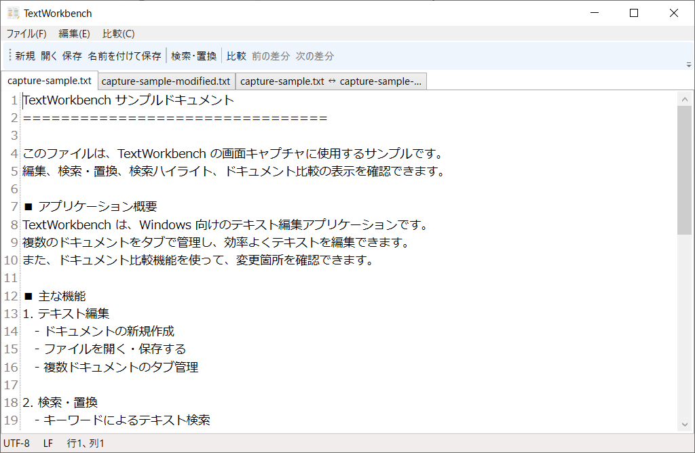
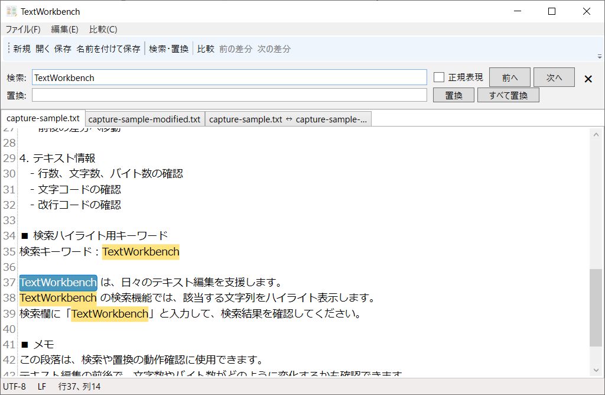
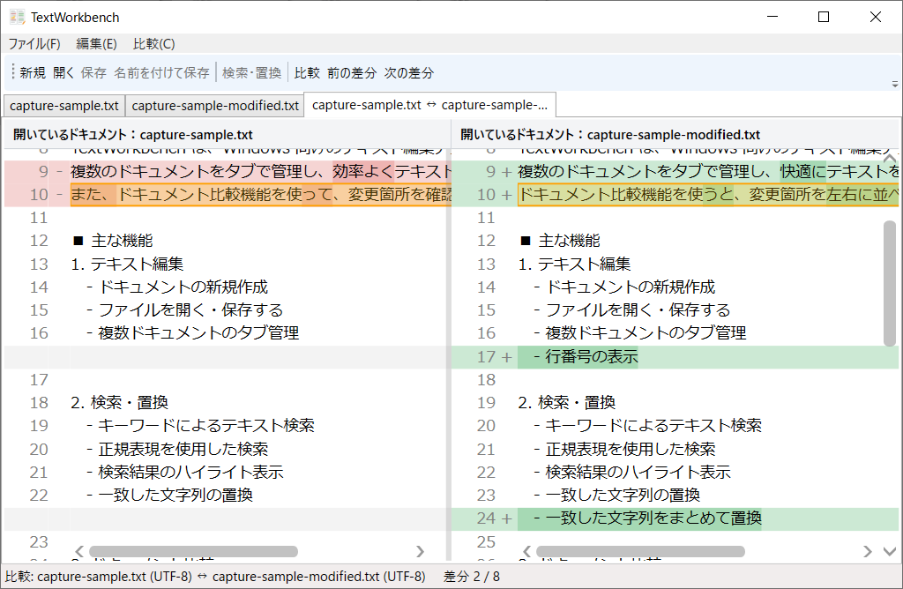
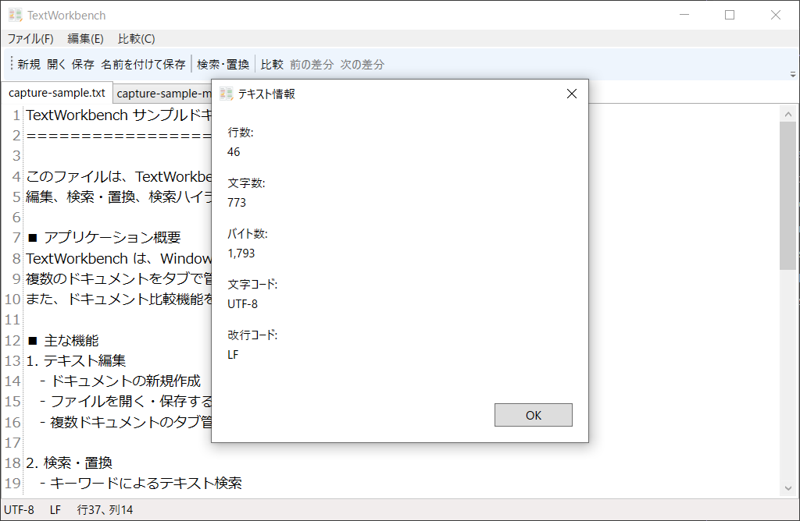

# TextWorkbench

TextWorkbenchは、Windows向けのテキスト編集アプリケーションです。

複数のドキュメントをタブで管理し、テキストの編集、検索・置換、ドキュメント間の差分比較などを行うことができます。

テキスト編集とドキュメント比較を手軽に行えるツールを目指して開発しています。

## スクリーンショット

アプリケーションの画面を紹介します。

| メイン画面 | 検索・置換 |
|:---:|:---:|
|  |  |
| ドキュメント比較 | テキスト情報 |
|  |  |

## 主な機能

- **テキスト編集**
  - ドキュメントの新規作成、ファイルの開く・保存
  - タブによる複数ドキュメントの管理
  - 行番号の表示
  - 元に戻す・やり直し、切り取り・コピー・貼り付け

- **検索・置換**
  - テキスト検索
  - 正規表現による検索
  - 検索結果のハイライト表示
  - 前後の検索結果への移動
  - 置換、すべて置換

- **ドキュメント比較**
  - 開いているドキュメント同士の比較
  - 開いているドキュメントと保存済みファイルの比較
  - 差分の左右並列表示
  - 次・前の差分への移動

- **テキスト情報**
  - 行数
  - 文字数
  - バイト数
  - 文字コード
  - 改行コード

- **文字コード・改行コード**
  - UTF-8、UTF-8 BOM、Shift-JISに対応
  - CRLF、LF、CRの改行コードに対応

## 動作環境

- Windows
- .NET 10

## 使用技術

| 技術                    | 用途         |
| :-------------------- | :--------- |
| C#                    | アプリケーション開発 |
| .NET 10               | 実行基盤       |
| WPF                   | デスクトップUI   |
| MVVM                  | アプリケーション設計 |
| AvalonEdit            | テキストエディタ   |
| CommunityToolkit.Mvvm | MVVM実装支援   |
| DiffPlex              | テキスト差分比較   |
| DiffPlex.Wpf          | WPF向け差分表示  |

## 使用ライブラリへの謝辞

TextWorkbenchは、以下のオープンソースライブラリを利用しています。
各ライブラリの開発者およびコントリビューターの皆さまに感謝します。

- [AvalonEdit](https://github.com/icsharpcode/AvalonEdit) ([NuGet](https://www.nuget.org/packages/AvalonEdit/)) - WPF向けテキストエディタコンポーネント（6.3.1.120）
- [CommunityToolkit.Mvvm](https://github.com/CommunityToolkit/dotnet) ([ドキュメント](https://learn.microsoft.com/dotnet/communitytoolkit/mvvm/)、[NuGet](https://www.nuget.org/packages/CommunityToolkit.Mvvm/)) - MVVM実装を支援するライブラリ（8.4.2）
- [DiffPlex](https://github.com/mmanela/diffplex) ([NuGet](https://www.nuget.org/packages/DiffPlex/)) - テキストの差分を生成するライブラリ（1.9.0）
- [DiffPlex.Wpf](https://github.com/mmanela/diffplex) ([NuGet](https://www.nuget.org/packages/DiffPlex.Wpf/)) - WPF向けの差分表示コンポーネント（1.9.1）

## ビルド・実行方法

### 1. リポジトリを取得

```bash
git clone https://github.com/yuzuasan/TextWorkbench.git
```

### 2. リポジトリへ移動

```bash
cd TextWorkbench
```

### 3. ビルド

```bash
dotnet build TextWorkbench.slnx --configuration Release
```

### 4. アプリケーションの実行

```bash
dotnet run --project TextWorkbench/TextWorkbench.csproj
```

.NET SDKおよび必要なNuGetパッケージが利用可能な環境で実行してください。

## プロジェクト構成

```text
TextWorkbench/
├── TextWorkbench/
│   ├── Application/       # ユースケース、サービス、インターフェース
│   ├── Domain/            # ドメインモデル、列挙型
│   ├── Infrastructure/    # ファイルI/O、文字コード、差分処理
│   ├── Presentation/      # View、ViewModel、Behavior
│   ├── Assets/            # アプリケーションのアイコンなど
│   └── TextWorkbench.csproj
├── TextWorkbench.Tests/   # テストプロジェクト
├── docs/                  # 設計書・開発関連ドキュメント
│   └── images/            # README掲載用スクリーンショット
├── TextWorkbench.slnx
├── AGENTS.md
└── README.md
```

## ライセンス

本ソフトウェアは [MIT License](LICENSE) のもとで公開しています。